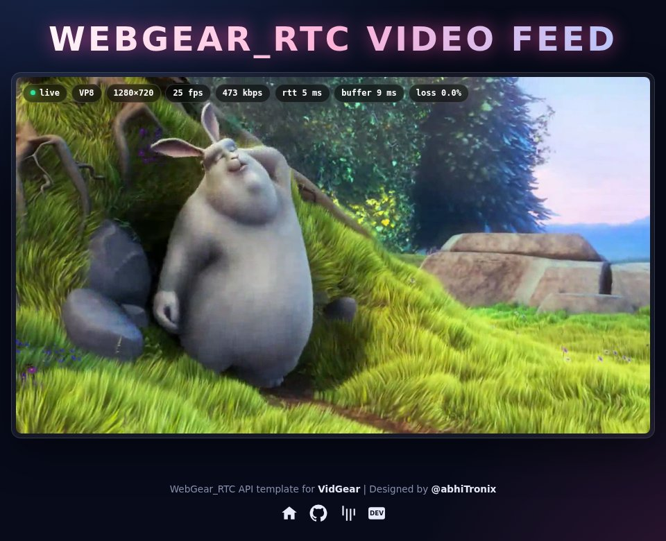

# Vidgear Vitals :rotating_light:

[](https://github.com/abhiTronix/vidgear-vitals/actions/workflows/playwright.yml)

This repository maintains updates for additional vital frontend data-files for [vidgear](https://github.com/abhiTronix/vidgear) APIs. These files are auto-downloaded by WebGear & WebGear_RTC APIs on first run _(or when `overwrite_default_files=True`)_.

&nbsp;

### WebGear default theme


* **Description:** Default theme files for [WebGear API](https://abhitronix.github.io/vidgear/latest/gears/webgear/).
* **Features:**
	* **Low-latency H.264 engine:** Streams H.264 Annex-B access units over WebSocket (`/ws/video`), decoded off main-thread by a WebCodecs `VideoDecoder` inside a Web Worker and painted on `<canvas>`. Codec string (`avc1.PPCCLL`) is derived from the stream's SPS, and decode backlog is auto-dropped to the next keyframe.
	* **Automatic MJPEG fallback:** Falls back to the classic `` Motion-JPEG feed when WebGear runs with `streaming_mode="mjpeg"`, WebCodecs is unavailable _(e.g. insecure context: plain HTTP on non-localhost hosts)_, or the WebSocket stream fails.
	* **Telemetry HUD:** Live status, codec, resolution, FPS, bandwidth and decode-latency pills.
	* **Zero external dependencies:** No CDN fonts, icon packs or scripts _(native Fullscreen API, inline SVG icons, system fonts)_. Whole theme is ~25KB.
	* Responsive, modern dark UI with click-to-toggle fullscreen.
* **Compatibility:** H.264 streaming needs vidgear v0.3.7+ _(`streaming_mode="h264"`)_. With older vidgear versions, theme automatically uses MJPEG.
* **Author:** [@abhiTronix](https://github.com/abhiTronix)
* **License:** Apache License 2.0
* **Version:** v0.2.0
* **Files MD5 Checksums:**
	```shell
	9e4d3304ac51b29b2f0d5dcb524a46bf  webgear/static/img/favicon-32x32.png
	0a43b8c57010152032de97693bbeb625  webgear/static/css/custom.css
	03ac309c45e4e45bb239ccc1a90b39cb  webgear/static/js/custom.js
	3ddbfe6aeed9bbcd752d3e7fcff26f2d  webgear/static/js/videoFrameDecoderWorker.js
	6dd9d207b45a8fca70cced1403abbef6  webgear/templates/404.html
	c80909c10d4e2dd5c55310f360cfcb19  webgear/templates/index.html
	0acc0384ce0422a9fee4998236676c33  webgear/templates/500.html
	978543418ff63e60fb34a74abbce6b7e  webgear/templates/base.html
	```

### WebGear_RTC default theme



* **Description:** Default theme files for [WebGear_RTC API](https://abhitronix.github.io/vidgear/latest/gears/webgear_rtc/).
* **Features:**
	* **Real-time Performance Overlay:** Live status, codec, resolution, FPS, bitrate, round-trip time, jitter-buffer delay and packet-loss pills, read every second from the browser's WebRTC `getStats()`. A stalled stream _(connected, but no new frames)_ is flagged and re-negotiated.
	* **Resilient connection:** Reconnects with exponential backoff _(1-10s)_ when the peer connection fails or stalls, frees its server-side peer with `navigator.sendBeacon` when page is hidden/reloaded, reconnects on back/forward cache restore, and shows `ended` once the stream is over _(HTTP `503`)_. No `alert()` popups.
	* **Configurable ICE:** STUN/TURN servers come from the server _(`data-ice-servers`, filled by WebGear_RTC's `ice_servers`)_, with ICE gathering capped at 3s. No hard-coded public STUN server.
	* **Zero external dependencies:** No CDN fonts, icon packs or scripts _(`fetch` instead of axios, native Fullscreen API, inline SVG icons, system fonts)_. Endpoints are relative, so it also works behind reverse-proxy sub-paths.
	* Same responsive, modern dark UI as WebGear theme, with click-to-toggle fullscreen.
* **Compatibility:** Works with any vidgear version. Per-peer close, `ended` status and `ice_servers` need vidgear v0.3.7+; with older versions, the page still streams _(using no STUN server)_.
* **Author:** [@abhiTronix](https://github.com/abhiTronix)
* **License:** Apache License 2.0
* **Version:** v0.2.0
* **Files MD5 Checksums:**
	```shell
	9e4d3304ac51b29b2f0d5dcb524a46bf  webgear_rtc/static/img/favicon-32x32.png
	18196508b7a4307b8ce5f58de042930d  webgear_rtc/static/css/custom.css
	c68df25968fccc898cd5dab3fc6f6061  webgear_rtc/static/js/custom.js
	6dd9d207b45a8fca70cced1403abbef6  webgear_rtc/templates/404.html
	f50171883e57099bc01024ec4b36be58  webgear_rtc/templates/index.html
	0acc0384ce0422a9fee4998236676c33  webgear_rtc/templates/500.html
	41f484d6dcdcd1cddde974e15c6604a0  webgear_rtc/templates/base.html
	```

&nbsp;

### Testing

Both themes are tested end-to-end in real Chromium with [Playwright](https://playwright.dev/python/) against live vidgear servers _(Python 3.14)_. WebGear: H.264 streaming, every MJPEG fallback path, fullscreen toggle, error pages and static assets. WebGear_RTC: WebRTC stream & performance overlay, two viewers _(default & live-broadcast)_, offer failures, page reload, reconnect after server drop, fullscreen toggle, error pages, static assets and zero third-party requests:

```sh
pip install "vidgear[asyncio]" pytest-playwright   # FFmpeg (with libx264) must be on PATH
python -m playwright install --with-deps chromium
pytest tests -v
```

> CI installs vidgear from the `testing` branch by default; pick another ref via the workflow's manual `vidgear_ref` input.

&nbsp;

### Copyright

**Copyright © abhiTronix 2019-2026**

This library is released under the **[Apache 2.0 License](https://github.com/abhiTronix/vidgear-vitals/blob/main/LICENSE)**.
