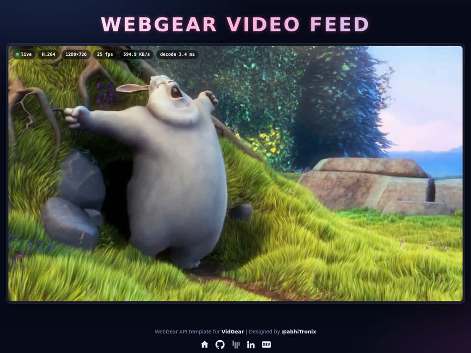

# Vidgear Vitals :rotating_light:

[](https://github.com/abhiTronix/vidgear-vitals/actions/workflows/playwright.yml)

This repository maintains updates for additional vital frontend data-files for [vidgear](https://github.com/abhiTronix/vidgear) APIs. These files are auto-downloaded by WebGear & WebGear_RTC APIs on first run _(or when `overwrite_default_files=True`)_.

&nbsp;

### WebGear default theme



* **Description:** Default theme files for [WebGear API](https://abhitronix.github.io/vidgear/latest/gears/webgear/).
* **Features:**
	* **Low-latency H.264 engine:** Streams H.264 Annex-B access units over WebSocket (`/ws/video`), decoded off main-thread by a WebCodecs `VideoDecoder` inside a Web Worker and painted on `<canvas>`. Codec string (`avc1.PPCCLL`) is derived from the stream's SPS, and decode backlog is auto-dropped to the next keyframe.
	* **Automatic MJPEG fallback:** Falls back to the classic `` Motion-JPEG feed when WebGear runs with `streaming_mode="mjpeg"`, WebCodecs is unavailable _(e.g. insecure context: plain HTTP on non-localhost hosts)_, or the WebSocket stream fails.
	* **Telemetry HUD:** Live status, codec, resolution, FPS, bandwidth and decode-latency pills.
	* **Zero external dependencies:** No CDN fonts, icon packs or scripts _(native Fullscreen API, inline SVG icons, system fonts)_. Whole theme is ~25KB.
	* Responsive, modern dark UI with click-to-toggle fullscreen.
* **Compatibility:** H.264 streaming needs vidgear v0.3.7+ _(`streaming_mode="h264"`, default)_. With older vidgear versions, theme automatically uses MJPEG.
* **Author:** [@abhiTronix](https://github.com/abhiTronix)
* **License:** Apache License 2.0
* **Version:** v0.2.0
* **Files MD5 Checksums:**
	```shell
	9e4d3304ac51b29b2f0d5dcb524a46bf  webgear/static/img/favicon-32x32.png
	0a43b8c57010152032de97693bbeb625  webgear/static/css/custom.css
	03ac309c45e4e45bb239ccc1a90b39cb  webgear/static/js/custom.js
	3ddbfe6aeed9bbcd752d3e7fcff26f2d  webgear/static/js/videoFrameDecoderWorker.js
	6dd9d207b45a8fca70cced1403abbef6  webgear/templates/404.html
	c80909c10d4e2dd5c55310f360cfcb19  webgear/templates/index.html
	0acc0384ce0422a9fee4998236676c33  webgear/templates/500.html
	1536f3091986a7ee95bd1746ad9ca21a  webgear/templates/base.html
	```

### WebGear_RTC default theme


* **Description:** Default theme files for [WebGear_RTC API](https://abhitronix.github.io/vidgear/latest/gears/webgear_rtc/).
* **Author:** [@abhiTronix](https://github.com/abhiTronix)
* **License:** Apache License 2.0
* **Version:** v0.1.2
* **Files MD5 Checksums:**
	```shell
	9e4d3304ac51b29b2f0d5dcb524a46bf  webgear_rtc/static/img/favicon-32x32.png
	a0fac71498524647558447cfdfc6c953  webgear_rtc/static/css/custom.css
	29da26abb4c0dff056139110b3163b11  webgear_rtc/static/js/custom.js
	6dd9d207b45a8fca70cced1403abbef6  webgear_rtc/templates/404.html
	aafa5ad625b9aa2cb8d138769ce50532  webgear_rtc/templates/index.html
	0acc0384ce0422a9fee4998236676c33  webgear_rtc/templates/500.html
	2b8434ccdde8cc3e063a2d2509d02ee3  webgear_rtc/templates/base.html
	```

&nbsp;

### Testing

WebGear theme is tested end-to-end in real Chromium with [Playwright](https://playwright.dev/python/) against a live vidgear WebGear server _(Python 3.14)_, covering H.264 streaming, every MJPEG fallback path, fullscreen toggle, error pages and static assets:

```sh
pip install "vidgear[asyncio]" pytest-playwright   # FFmpeg (with libx264) must be on PATH
python -m playwright install --with-deps chromium
pytest tests -v
```

> CI installs vidgear from the `testing` branch by default; pick another ref via the workflow's manual `vidgear_ref` input.

&nbsp;

### Copyright

**Copyright © abhiTronix 2019-2026**

This library is released under the **[Apache 2.0 License](https://github.com/abhiTronix/vidgear-vitals/blob/main/LICENSE)**.
